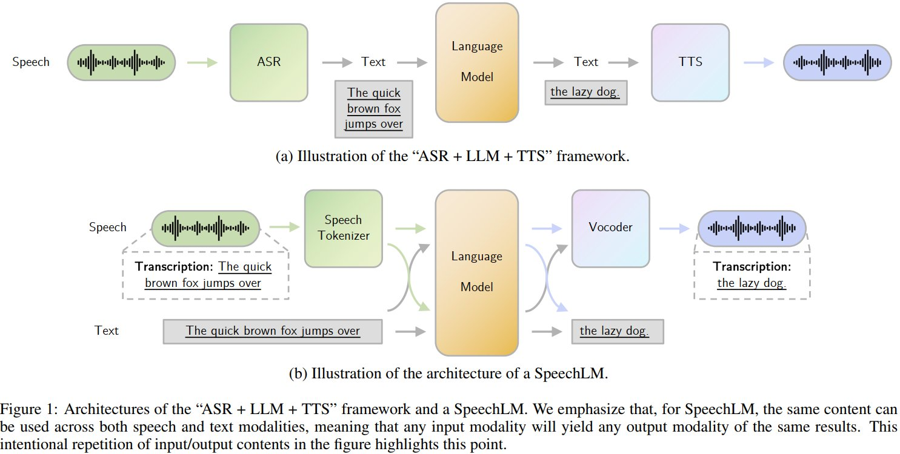
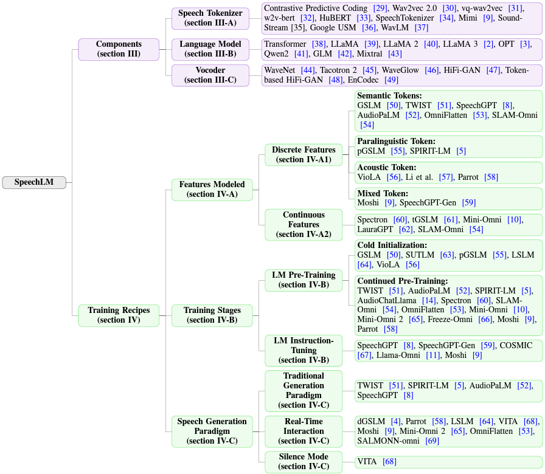

# Awesome-SpeechLM-Survey
<!-- [](https://huggingface.co/datasets/qqjz/VoxEval) -->
[](https://arxiv.org/abs/2410.03751)

**🎉🎉🎉Our survey paper "Recent Advances in Speech Language Models: A Survey" has been accepted to ACL 2025 main conference!**

This is the Github repository for paper: [*Recent Advances in Speech Language Models: A Survey*](https://arxiv.org/abs/2410.03751). In this paper, we survey the field of Speech Language Models (SpeechLMs), which are capable of performing end-to-end speech interactions with humans and serve as autoregressive foundation models.

## Contents

- [Speech Language Models](#speech-language-models-speechlms)
- [Full-Duplex Speech Language Models](#full-duplex-speech-language-models)
- [Full-Duplex Control and Turn-Taking Components](#full-duplex-control-and-turn-taking-components)
- [Commercial and Closed Voice Systems](#commercial-and-closed-voice-systems)
- [Speech Interaction with Background Agents](#speech-interaction-with-background-agents)
- [SpeechLM Training, Alignment, and Extensions](#speechlm-training-alignment-and-extensions)
- [Large Audio Language Models](#large-audio-language-models-lalms)
- [Related Audio and Speech Generation Systems](#related-audio-and-speech-generation-systems)
- [SpeechLM Tokenizers](#speechlm-tokenizers)
- [Popular Training Datasets](#popular-training-datasets)
- [Evaluation Benchmarks](#evaluation-benchmarks)
- [Full-Duplex and Turn-Taking Evaluation](#full-duplex-and-turn-taking-evaluation)
- [Evaluation Toolkits](#evaluation-toolkits)

# News
- Our paper [*TextPro-SLM: Minimizing Modality Gap from the Input Side: Your Speech LLM Can Be a Prosody-Aware Text LLM*](https://arxiv.org/abs/2605.05927) has been accepted to **NeurIPS 2026**! 🎉
- The short version of our [audio reasoning survey paper](https://arxiv.org/abs/2605.21008) has been accepted to **EMNLP 2026 Findings**! 🎉
- Our paper [*SpeechSense: A Paralinguistic-Focused Dataset for Fine-Grained Speech Sentiment Analysis*](https://arxiv.org/abs/2608.17931) has been accepted to **ACM Multimedia 2026 (Dataset Track)**! 🎉
- We have released [*A Survey of Audio Reasoning in Multimodal Foundation Models*](https://arxiv.org/abs/2605.21008) on arXiv! 🎉
- Our paper [*TurnGuide: Enhancing Meaningful Full Duplex Spoken Interactions via Dynamic Turn-Level Text-Speech Interleaving*](https://arxiv.org/abs/2508.07375) has been accepted to **Interspeech 2026 Long Paper Track as an Oral presentation**! 🎉 Check it out on [GitHub](https://github.com/dreamtheater123/TurnGuide).
- Our paper [*MTR-DuplexBench: Towards a Comprehensive Evaluation of Multi-Round Conversations for Full-Duplex Speech Language Models*](https://arxiv.org/abs/2511.10262) has been accepted to **Findings of ACL 2026**! 🎉 Check it out on [GitHub](https://github.com/ZhangHe0918/MTR-DuplexBench).
- Our paper [*VoxEval: Benchmarking the Knowledge Understanding Capabilities of End-to-End Spoken Language Models*](https://arxiv.org/abs/2501.04962) has been accepted to **ACL 2025 Main Conference**! 🎉 Check it out on [GitHub](https://github.com/dreamtheater123/VoxEval).

## Introduction
Why SpeechLMs? SpeechLMs are used for end-to-end speech-based interactions. Traditional ASR + LLM + TTS setups suffer from information loss and cumulative errors during conversion. SpeechLMs directly model speech data, capturing both semantic and paralinguistic information for richer interactions!

In this repository, we distinguish between two closely related model families:

- **Speech Language Models (SpeechLMs)** directly accept speech/audio and generate speech/audio. They may operate in turn-based, streaming, or full-duplex settings, but do not rely on an external ASR-LLM-TTS cascade as their core interaction mechanism.
- **Large Audio Language Models (LALMs)** use a generative language model to understand speech, environmental sound, or music and produce text. Speech-centric LLM-ASR models are included as a dedicated LALM category, while conventional encoder-only ASR models are outside the scope of this list.

Models supporting both text and speech output are listed under SpeechLMs to avoid duplication.

Related [turn-taking controllers](#full-duplex-control-and-turn-taking-components) and [background-agent frameworks](#speech-interaction-with-background-agents) are tracked separately from complete speech language models.



## Taxonomy
We introduce a novel taxonomy for SpeechLMs, categorizing them based on their architecture and training recipes.



## Speech Language Models (SpeechLMs)

The models below support speech/audio input and speech/audio output within the model. Turn-based and streaming models are listed here; full-duplex models are collected in the [dedicated subsection](#full-duplex-speech-language-models). New entries use the year of their first public paper or model release, rather than a later conference publication. Resource availability for the new full-duplex entries was checked on **2026-10-12**.

| Model | Paper / Release | Year | Interaction |
|-------|-----------------|------|-------------|
| Qwen3.5-Omni | [Qwen3.5-Omni Technical Report](https://arxiv.org/abs/2604.15804) | 2026 | Streaming omni-modal |
| Covo-Audio-Chat | [Covo-Audio Technical Report](https://arxiv.org/abs/2602.09823) · [Code](https://github.com/Tencent/Covo-Audio) · [Weights](https://huggingface.co/tencent/Covo-Audio-Chat) | 2026 | End-to-end speech interaction; the paper's Chat-FD variant is listed separately below |
| MiMo-Audio | [MiMo-Audio Technical Report](https://arxiv.org/abs/2512.23808) | 2025 | Spoken dialogue and audio generation |
| Fun-Audio-Chat | [Fun-Audio-Chat](https://arxiv.org/abs/2512.20156) · [Code](https://github.com/FunAudioLLM/Fun-Audio-Chat) · [Weights](https://huggingface.co/FunAudioLLM/Fun-Audio-Chat-8B) | 2025 | End-to-end speech interaction; public 8B release distinguished from the paper's full-duplex extension |
| LFM2-Audio | [LFM2 Technical Report](https://arxiv.org/abs/2511.23404) | 2025 | Real-time speech-to-speech |
| MOSS-Speech | [MOSS-Speech](https://arxiv.org/abs/2510.00499) | 2025 | Native speech-to-speech |
| Qwen3-Omni | [Qwen3-Omni Technical Report](https://arxiv.org/abs/2509.17765) | 2025 | Streaming omni-modal |
| Step-Audio 2 | [Step-Audio 2 Technical Report](https://arxiv.org/abs/2507.16632) | 2025 | End-to-end speech interaction |
| Audio Flamingo 3 | [Audio Flamingo 3: Advancing Audio Intelligence with Fully Open Large Audio Language Models](https://arxiv.org/abs/2507.08128) | 2025 | General audio and voice-to-voice |
| OpenS2S | [OpenS2S: Advancing Fully Open-Source End-to-End Empathetic Large Speech Language Model](https://arxiv.org/abs/2507.05177) | 2025 | End-to-end speech-to-speech |
| NTPP | [Generative Speech Language Modeling for Dual-Channel Spoken Dialogue via Next-Token-Pair Prediction](https://arxiv.org/abs/2506.00975) | 2025 | Dual-channel dialogue |
| VITA-Audio | [Fast Interleaved Cross-Modal Token Generation for Efficient Large Speech-Language Model](https://arxiv.org/abs/2505.03739) | 2025 | Streaming speech interaction |
| Voila | [Voice-Language Foundation Models for Real-Time Autonomous Interaction and Voice Role-Play](https://arxiv.org/abs/2505.02707) | 2025 | Real-time interaction |
| LLaMA-Omni 2 | [LLM-based Real-time Spoken Chatbot with Autoregressive Streaming Speech Synthesis](https://arxiv.org/abs/2505.02625) | 2025 | Streaming speech-to-speech |
| Kimi-Audio | [Kimi-Audio Technical Report](https://arxiv.org/abs/2504.18425) | 2025 | Audio understanding and generation |
| Qwen2.5-Omni | [Qwen2.5-Omni Technical Report](https://arxiv.org/abs/2503.20215) | 2025 | Streaming omni-modal |
| Slamming | [Training a Speech Language Model on One GPU in a Day](https://arxiv.org/abs/2502.15814) | 2025 | Speech-to-speech |
| Baichuan-Audio | [A Unified Framework for End-to-End Speech Interaction](https://arxiv.org/abs/2502.17239) | 2025 | End-to-end speech interaction |
| Step-Audio | [Unified Understanding and Generation in Intelligent Speech Interaction](https://arxiv.org/abs/2502.11946) | 2025 | Speech interaction |
| VITA-1.5 | [Towards GPT-4o Level Real-Time Vision and Speech Interaction](https://arxiv.org/abs/2501.01957) | 2025 | Real-time omni-modal |
| MiniCPM-o | [A GPT-4o Level MLLM for Vision, Speech and Multimodal Live Streaming on Your Phone](https://github.com/OpenBMB/MiniCPM-o) | 2025 | Streaming omni-modal |
| SLAM-Omni | [Timbre-Controllable Voice Interaction System with Single-Stage Training](https://arxiv.org/abs/2412.15649) | 2024 | Voice interaction |
| Lyra | [An Efficient and Speech-Centric Framework for Omni-Cognition](https://arxiv.org/abs/2412.09501) | 2024 | Speech interaction |
| Flow-Omni | [Continuous Speech Tokens Makes LLMs Robust Multi-Modality Learners](https://arxiv.org/abs/2412.04917) | 2024 | Speech understanding and generation |
| GLM-4-Voice | [Towards Intelligent and Human-Like End-to-End Spoken Chatbot](https://arxiv.org/abs/2412.02612) | 2024 | End-to-end speech interaction |
| Scaling Speech-Text Pre-training | [Scaling Speech-Text Pre-training with Synthetic Interleaved Data](https://arxiv.org/abs/2411.17607) | 2024 | Speech-text generation |
| Freeze-Omni | [A Smart and Low Latency Speech-to-speech Dialogue Model with Frozen LLM](https://arxiv.org/abs/2411.00774) | 2024 | Streaming speech-to-speech |
| IntrinsicVoice | [Empowering LLMs with Intrinsic Real-time Voice Interaction Abilities](https://arxiv.org/abs/2410.08035) | 2024 | Real-time voice interaction |
| EMOVA | [Empowering Language Models to See, Hear and Speak with Vivid Emotions](https://arxiv.org/abs/2409.18042) | 2024 | Emotional speech interaction |
| LLaMA-Omni | [Seamless Speech Interaction with Large Language Models](https://arxiv.org/abs/2409.06666) | 2024 | Streaming speech-to-speech |
| Mini-Omni | [Language Models Can Hear, Talk While Thinking in Streaming](https://arxiv.org/abs/2408.16725) | 2024 | Streaming speech-to-speech |
| VITA | [Towards Open-Source Interactive Omni Multimodal LLM](https://arxiv.org/abs/2408.05211) | 2024 | Real-time omni-modal |
| Spirit-LM | [Interleaved Spoken and Written Language Model](https://arxiv.org/abs/2402.05755) | 2024 | Interleaved speech-text generation |
| SpeechGPT-Gen | [Scaling Chain-of-Information Speech Generation](https://arxiv.org/abs/2401.13527) | 2024 | Speech generation |
| GPST | [Generative Pre-trained Speech Language Model with Efficient Hierarchical Transformer](https://aclanthology.org/2024.acl-long.97) | 2024 | Speech generation and continuation |
| Parrot | [Autoregressive Spoken Dialogue Language Modeling with Decoder-only Transformers](https://openreview.net/forum?id=Ttndg2Jl5F) | 2023 | Spoken dialogue modeling |
| SUTLM | [Toward Joint Language Modeling for Speech Units and Text](https://arxiv.org/abs/2310.08715) | 2023 | Speech-text generation |
| tGSLM | [Generative Spoken Language Model Based on Continuous Word-Sized Audio Tokens](https://arxiv.org/abs/2310.05224) | 2023 | Spoken language generation |
| LauraGPT | [Listen, Attend, Understand, and Regenerate Audio with GPT](https://arxiv.org/abs/2310.04673) | 2023 | Audio understanding and regeneration |
| Spectron | [Spoken Question Answering and Speech Continuation Using Spectrogram-Powered LLM](https://openreview.net/forum?id=izrOLJov5y) | 2023 | Spoken QA and continuation |
| VoxtLM | [Unified Decoder-Only Models for Speech Recognition, Synthesis, and Continuation](https://ieeexplore.ieee.org/document/10447112) | 2023 | Speech-text generation |
| TWIST | [Textually Pretrained Speech Language Models](https://proceedings.neurips.cc/paper_files/paper/2023/hash/c859b99b5d717c9035e79d43dfd69435-Abstract-Conference.html) | 2023 | Spoken language modeling |
| AudioPaLM | [A Large Language Model That Can Speak and Listen](https://arxiv.org/abs/2306.12925) | 2023 | Speech understanding and generation |
| VioLA | [Unified Codec Language Models for Speech Recognition, Synthesis, and Translation](https://arxiv.org/abs/2305.16107) | 2023 | Speech understanding and generation |
| SpeechGPT | [Empowering Large Language Models with Intrinsic Cross-Modal Conversational Abilities](https://arxiv.org/abs/2305.11000) | 2023 | Speech conversation |
| dGSLM | [Generative Spoken Dialogue Language Modeling](https://direct.mit.edu/tacl/article/doi/10.1162/tacl_a_00545/115240/Generative-Spoken-Dialogue-Language-Modeling) | 2023 | Spoken dialogue modeling |
| pGSLM | [Text-Free Prosody-Aware Generative Spoken Language Modeling](https://arxiv.org/abs/2109.03264) | 2021 | Prosody-aware spoken language modeling |
| GSLM | [On Generative Spoken Language Modeling from Raw Audio](https://direct.mit.edu/tacl/article/doi/10.1162/tacl_a_00430/108611/On-Generative-Spoken-Language-Modeling-from-Raw) | 2021 | Spoken language modeling |

### Full-Duplex Speech Language Models

Full-duplex interaction allows incoming speech to affect the system while it is speaking. Native full-duplex models learn concurrent listening, speaking, and conversational timing within the model. Streaming output or an external interruption detector alone does not establish native full-duplex behavior; the notes below distinguish these designs. Related evaluations are collected under [Full-Duplex and Turn-Taking Evaluation](#full-duplex-and-turn-taking-evaluation).

#### Open Code and Open Weights

Code and checkpoint availability are recorded separately. Open weights do not imply unrestricted use: the linked repositories and model cards specify their respective licenses, including gated access where applicable.

| Model | Paper / Release | Code | Weights | Year | Focus |
|-------|-----------------|------|---------|------|-------|
| NemotronLabs VoiceChat | [An Open Full-duplex Speech-to-Speech Model with Tool Calling Capabilities](https://arxiv.org/abs/2609.21967) | [Code](https://github.com/NVIDIA-NeMo/Speech/tree/nemotron-labs-voicechat) | [11B](https://huggingface.co/nvidia/NVIDIA-NemotronLabs-VoiceChat-11B) | 2026 | Native full-duplex speech and tool calling |
| Realtime-Venus | [A full-duplex interaction system with asynchronous delegation](https://arxiv.org/abs/2609.13814) | [Code](https://github.com/inclusionAI/Realtime-Venus) | [Audio / Omni](https://huggingface.co/inclusionAI/Realtime-Venus) | 2026 | Continuous speech or audiovisual interaction with asynchronous background reasoning and tools |
| Gander | [Multimodal Duplex Interaction Agent](https://arxiv.org/abs/2609.08977) | [Code](https://github.com/Omni-Interaction-Gander/Omni-Interaction-Agent) | [Thinker / Talker](https://huggingface.co/Gander-Omni/Gander) | 2026 | MiniCPM-o 4.5-based full-duplex frontend with an asynchronous Brain; see [agent architecture](#speech-interaction-with-background-agents) |
| Lychee-FD | [Hierarchical Acoustic-Semantic Modeling: Modality Separation and Semantic Coherence for Full-Duplex SLMs](https://arxiv.org/abs/2607.06540) | [Code](https://github.com/HITsz-TMG/Lychee-FD) | [Weights](https://huggingface.co/HIT-TMG/Lychee-FD) | 2026 | Hierarchical acoustic-semantic modeling |
| BayLing-Duplex | [Native Full-Duplex Speech Dialogue with a Single Autoregressive LLM](https://arxiv.org/abs/2606.14528) | [Code](https://github.com/BayLing-Models/BayLing-Duplex) | [Weights](https://huggingface.co/BayLing-Models/BayLing-Duplex) | 2026 | Native turn-taking and interruption control without an external VAD |
| DuplexOmni | [Real-Time Listening, Seeing, Thinking, and Speaking for Full-Duplex Interaction](https://arxiv.org/abs/2606.09186) | [Code](https://github.com/MuyeHuang/DuplexOmni) | [Weights](https://huggingface.co/MuyeHuang/DuplexOmni) | 2026 | Full-duplex multimodal interaction and separate slower thinking |
| MiniCPM-o 4.5 | [MiniCPM-o 4.5](https://arxiv.org/abs/2604.27393) | [Code](https://github.com/OpenBMB/MiniCPM-o) | [Weights](https://huggingface.co/openbmb/MiniCPM-o-4_5) | 2026 | Concurrent video/audio input and speech/text output |
| PersonaPlex | [Voice and Role Control for Full Duplex Conversational Speech Models](https://arxiv.org/abs/2602.06053) | [Code](https://github.com/NVIDIA/personaplex) | [7B, gated](https://huggingface.co/nvidia/personaplex-7b-v1) | 2026 | Voice and role conditioning in full-duplex dialogue |
| F-Actor | [Controllable Conversational Behaviour in Full-Duplex Models](https://arxiv.org/abs/2601.11329) | [Code](https://github.com/MaikeZuefle/f-actor) | [Weights](https://huggingface.co/maikezu/f-actor) · [Streaming variant](https://huggingface.co/JSALT2026-Conv-AI-Simulator/f-actor-mimi-fisher) | 2026 | Instruction-controlled conversational behavior, voice, and initiation |
| FLM-Audio | [Natural Monologues Improves Native Full-Duplex Chatbots via Dual Training](https://arxiv.org/abs/2509.02521) | [Code and deployment](https://github.com/cofe-ai/flm-audio) | [Model releases](https://huggingface.co/CofeAI) | 2025 | Native full-duplex interaction with internal monologue |
| TurnGuide | [Enhancing Meaningful Full Duplex Spoken Interactions via Dynamic Turn-Level Text-Speech Interleaving](https://arxiv.org/abs/2508.07375) | [Code](https://github.com/dreamtheater123/TurnGuide) | [2:1](https://huggingface.co/qqjz/turnguide_loss_2_1) · [3:1](https://huggingface.co/qqjz/turnguide_loss_3_1) | 2025 | Turn-level text-speech interleaving with aligned two-channel dialogue |
| Hertz-dev | [An Open Base Model for Conversational Speech](https://si.inc/posts/hertz-dev/) | [Code](https://github.com/Standard-Intelligence/hertz-dev) | [Weights](https://huggingface.co/si-pbc/hertz-dev) | 2024 | Base model for full-duplex conversational audio |
| Mini-Omni2 | [Towards Open-source GPT-4o with Vision, Speech and Duplex Capabilities](https://arxiv.org/abs/2410.11190) | [Code](https://github.com/gpt-omni/mini-omni2) | [Weights](https://huggingface.co/gpt-omni/mini-omni2) | 2024 | Omni-modal speech interaction with interruption support |
| Moshi | [A Speech-Text Foundation Model for Real-Time Dialogue](https://arxiv.org/abs/2410.00037) | [Code](https://github.com/kyutai-labs/moshi) | [Weights](https://huggingface.co/kyutai/moshiko-pytorch-bf16) | 2024 | Concurrent audio streams, text planning, and native conversational timing |

#### Commercial and Closed Full-Duplex Models

These systems explicitly describe full-duplex behavior in their official releases. Public product behavior does not necessarily disclose the underlying architecture or training recipe. Other real-time voice APIs and products remain in the [commercial voice systems list](#commercial-and-closed-voice-systems).

| System | Paper / Official Release / API | Year | Focus |
|--------|--------------------------------|------|-------|
| Qwen-Audio-3.1-Realtime | [Towards Reliable Agentic Voice Interaction](https://arxiv.org/abs/2609.25176) · [API model card](https://help.aliyun.com/en/model-studio/qwen-audio-3-1-realtime-plus) | 2026 | Real-time duplex speech, reasoning, tool execution, and coordination of speaking and acting; API model `qwen-audio-3.1-realtime-plus` |
| StepAudio 3 Realtime | [Technical report](https://arxiv.org/abs/2609.14005) · [Official release](https://static.stepfun.com/blog/stepaudio3/realtime/) · [API guide](https://platform.stepfun.ai/docs/en/guides/models/stepaudio-3-realtime) | 2026 | Full-duplex audio streams, Think-While-Speaking, and asynchronous tool execution |
| Qwen-Audio-3.0-Realtime Plus / Flash | [Realtime guide](https://help.aliyun.com/en/model-studio/qwen-audio-realtime-user-guides) · [Plus](https://help.aliyun.com/en/model-studio/qwen-audio-3-0-realtime-plus) · [Flash](https://help.aliyun.com/en/model-studio/qwen-audio-3-0-realtime-flash) | 2026 | Earlier real-time duplex speech models with tool calling; also used as frontends in Qwen-Audio-Agent |
| OpenAI GPT-Live / GPT-Live 1 API | [Introducing GPT-Live](https://openai.com/index/introducing-gpt-live/) · [API model card](https://developers.openai.com/api/docs/models/gpt-live-1) | 2026 | Concurrent listening and speaking; delegates reasoning and tool use to a backend agent |
| Seeduplex / Doubao Realtime Voice 3.0 | [Seed Full-Duplex Speech LLM](https://seed.bytedance.com/en/seeduplex) · [API documentation](https://www.volcengine.com/docs/DoubaoVoice/endtoend-realtime-voice-full-duplex-version) | 2026 | Native full-duplex interaction and interference suppression; 3.0 API provides a Realtime event protocol and function calling |

#### Research Models and Unreleased Variants

A paper, demo, or repository placeholder is not counted as a released implementation. "Not verified" means that a public checkpoint for this specific model or variant was not confirmed during the resource check.

| Model / Variant | Paper / Resources | Year | Availability and Focus |
|-----------------|-------------------|------|------------------------|
| SteerDuplex | [Steerable Duplex Speech Dialogue Models](https://arxiv.org/abs/2609.12623) · [Repository](https://github.com/Utkarsh4430/SteerDuplex) | 2026 | Steerable duplex behavior; repository says coming soon |
| DuplexSLA | [A Full-Duplex Spoken Language Model with Synchronized Speech, Language, and Action](https://arxiv.org/abs/2605.20755) · [Repository](https://github.com/hyzhang24/DuplexSLA) | 2026 | Joint speech, language, and action streams; inference code and checkpoints listed as coming soon |
| Covo-Audio-Chat-FD | [Covo-Audio Technical Report](https://arxiv.org/abs/2602.09823) · [Project](https://github.com/Tencent/Covo-Audio) | 2026 | Native full-duplex variant described in the paper; the linked public release is Covo-Audio-Chat, not a verified Chat-FD checkpoint |
| Fun-Audio-Chat full-duplex extension | [Fun-Audio-Chat](https://arxiv.org/abs/2512.20156) · [Project](https://github.com/FunAudioLLM/Fun-Audio-Chat) | 2025 | Paper describes a full-duplex extension; separate duplex checkpoint not verified |
| SALMONN-omni | [A Standalone Speech LLM without Codec Injection for Full-duplex Conversation](https://arxiv.org/abs/2505.17060) · [Project](https://github.com/bytedance/SALMONN) | 2025 | Codec-free token-space design; public checkpoint for this specific model not verified |
| MinMo | [A Multimodal Large Language Model for Seamless Voice Interaction](https://arxiv.org/abs/2501.06282) | 2025 | Full-duplex voice interaction; public checkpoint not verified |
| OmniFlatten | [An End-to-end GPT Model for Seamless Voice Conversation](https://arxiv.org/abs/2410.17799) · [Demo](https://omniflatten.github.io/) | 2024 | Unified sequence modeling for full-duplex conversation; public checkpoint not verified |
| SyncLLM | [Beyond Turn-Based Interfaces: Synchronous LLMs as Full-Duplex Dialogue Agents](https://arxiv.org/abs/2409.15594) · [Project](https://syncllm.cs.washington.edu/) | 2024 | Synchronized speech streams; public checkpoint not verified |
| LSLM | [Language Model Can Listen While Speaking](https://arxiv.org/abs/2408.02622) · [Demo](https://ziyang.tech/LSLM/) | 2024 | Listening while generating speech; public checkpoint not verified |

### Full-Duplex Control and Turn-Taking Components

These components predict when a dialogue system should listen, speak, wait, or yield. They include classification heads, single-token decision readouts, streaming state predictors, and semantic endpoint detectors. They require a host dialogue system and are not standalone speech-input/speech-output conversation models. Endpoint detection alone does not cover every full-duplex behavior, such as distinguishing an interruption from a backchannel while the assistant is speaking.

#### Released Decision Models and Detectors

Input modality and output labels are kept explicit: transcript-based detectors depend on upstream ASR, while audio-based detectors can use acoustic cues. Component labels are model-specific and do not define a shared state space. Code and model links describe the released artifacts checked on **2026-10-12**.

| Component | Input | Decision / Role | Paper / Code / Weights |
|-----------|-------|-----------------|------------------------|
| DuplexJev | Audio plus runtime-defined questions and answer options | Single-token option distributions for multiple decisions in one forward pass; supports turn state, barge-in decisions, and paralinguistic cues without decoding a transcript or free-form answer | [Paper](https://arxiv.org/abs/2610.02638) · [Code](https://github.com/adventists-ai/duplexjev) · [4B](https://huggingface.co/adventists-ai/DuplexJev-4B-Para) · [32B](https://huggingface.co/adventists-ai/DuplexJev-32B-Para) |
| XTurnix | Transcribed dialogue history and the assistant's listening/speaking state | Two state-conditioned binary decisions: keep listening vs start responding, or keep speaking vs stop and listen; single control-token output | [Paper](https://arxiv.org/abs/2610.04400) · [Code](https://github.com/xcc-zach/xturnix) · [Pretrained 0.6B](https://huggingface.co/xcczach/xturnix-pt) · [Chinese model](https://huggingface.co/xcczach/xturnix-zh-base) |
| X2-Turn | Streaming audio | Parallel ASR and turn-state heads on shared streaming representations; frame-synchronous states including `turn_end`, `backchannel`, and `uncertain` | [Paper](https://arxiv.org/abs/2608.10878) · [Code](https://github.com/X-Square-Robot/X2-Turn) · [4B weights](https://huggingface.co/x-square-robot/X2-Turn-4B-0812) |
| SoulX-Duplug | Streaming audio with jointly predicted ASR text | Text-guided semantic VAD and dialogue control; server reports `idle`, `nonidle`, and `speak`; `blank` denotes an incomplete buffered input chunk, not a conversational intent | [Paper](https://arxiv.org/abs/2603.14877) · [Code](https://github.com/Soul-AILab/SoulX-Duplug) · [Training code](https://github.com/Soul-AILab/SoulX-Duplug/tree/training-code) · [0.6B weights](https://huggingface.co/Soul-AILab/SoulX-Duplug-0.6B) |
| TurnSense / TurnSense 1.1 | Audio | Three-class semantic turn detection: `complete`, `incomplete`, and `invalid`; 1.1 improves English turn discrimination | [Code](https://github.com/Bairong-Xdynamics/TurnSense) · [FP32 / INT8 weights](https://huggingface.co/brgroup/TurnSense) |
| Easy Turn | Speech, combining acoustic and linguistic representations | Four states: `complete`, `incomplete`, `backchannel`, and `wait` | [Paper](https://arxiv.org/abs/2509.23938) · [Code](https://github.com/ASLP-lab/Easy-Turn) · [Weights](https://huggingface.co/ASLP-lab/Easy-Turn) |
| Smart Turn v3.2 | Audio from the current user turn | Whisper Tiny-based encoder with a linear endpoint classifier; used after VAD detects a pause to decide whether the turn is complete | [Code and training data](https://github.com/pipecat-ai/smart-turn) · [Weights](https://huggingface.co/pipecat-ai/smart-turn-v3) |
| TEN Turn Detection | Transcribed text | Semantic classification into `finished`, `unfinished`, and `wait` | [Code and test set](https://github.com/ten-framework/ten-turn-detection) · [Weights](https://huggingface.co/TEN-framework/TEN_Turn_Detection) |
| LiveKit Turn Detector | Transcribed conversation history | End-of-utterance probability from an end-of-message token readout; complements a VAD in the host pipeline | [Plugin code](https://github.com/livekit/agents/tree/main/livekit-plugins/livekit-plugins-turn-detector) · [Model card and weights](https://huggingface.co/livekit/turn-detector) |
| FireRedChat turn detector | Transcribed text | Compact end-of-turn classifier; a component of FireRedChat's cascaded dialogue system, separate from its personalized VAD | [System paper](https://arxiv.org/abs/2509.06502) · [Code](https://github.com/FireRedTeam/FireRedChat) · [Weights](https://huggingface.co/FireRedTeam/FireRedChat-turn-detector) |
| NAMO Turn Detector v1 Multilingual | Transcribed text | Binary end-of-turn vs continuation classification; multilingual semantic endpoint detector | [Model card, inference example, and weights](https://huggingface.co/videosdk-live/Namo-Turn-Detector-v1-Multilingual) |

#### Related Control Methods

These papers study independent duplex-control or endpoint-prediction modules. Where only a paper or test set is linked, a public model implementation and checkpoint have not been verified.

| Method | Year | Input and Control Mechanism | Resources |
|--------|------|-----------------------------|-----------|
| FastTurn | 2026 | Acoustic features fused with streaming CTC-derived semantic cues for early turn decisions from partial speech | [Paper](https://arxiv.org/abs/2604.01897) · [Test-set repository](https://github.com/ASLP-lab/FastTurn); repository currently releases the test set rather than model weights |
| JAL-Turn | 2026 | Speech-only acoustic-linguistic fusion with a shared frozen ASR encoder; predicts `hold` vs `shift` in parallel with recognition | [Paper](https://arxiv.org/abs/2603.26515) |
| Phoenix-VAD | 2025 | LLM-based semantic endpoint detection on streaming speech with sliding-window training; independently optimized from the dialogue model | [Paper](https://arxiv.org/abs/2509.20410) |
| LLM-Enhanced Dialogue Management | 2025 | A 0.5B semantic VAD predicts four control tokens for turn-switching, turn-keeping, pauses, and intentional vs unintentional barge-in | [Paper](https://arxiv.org/abs/2502.14145) |
| FlexDuo | 2025 | Plug-in duplex controller with an explicit idle state to filter irrelevant audio and buffer semantically incomplete input | [Paper](https://arxiv.org/abs/2502.13472) |

For component evaluation, see [TurnBench](https://arxiv.org/abs/2608.25218), the [Easy Turn test set](https://huggingface.co/datasets/ASLP-lab/Easy-Turn-Testset), and the [FastTurn test set](https://huggingface.co/datasets/ASLP-lab/FastTurn-Testset). [SoulX-Duplug-Eval](https://huggingface.co/datasets/Soul-AILab/SoulX-Duplug-Eval) additionally evaluates the behavior of integrated full-duplex dialogue systems. Their label spaces and evaluation protocols differ, so scores should not be compared across datasets as one ranking.

### Commercial and Closed Voice Systems

These entries are tracked separately because public information may describe a product or API rather than disclose a standalone end-to-end model architecture. The newer entries below document real-time speech, bidirectional streaming, or asynchronous tools without assigning an undisclosed native full-duplex architecture. Explicit full-duplex releases are listed [above](#commercial-and-closed-full-duplex-models).

| System | Release | Year | Notes |
|--------|---------|------|-------|
| Amazon Nova 2.5 Sonic | [Official release](https://aws.amazon.com/about-aws/whats-new/2026/10/amazon-nova-2.5-sonic/) | 2026 | Released 2026-10-05; real-time speech-to-speech, controllable turn-taking, and asynchronous tool calls; native full-duplex architecture not specified in the cited release |
| Qwen3.8-Omni-Flash-Realtime | [Official release](https://www.alibabacloud.com/blog/603580) · [API model card](https://help.aliyun.com/en/model-studio/qwen3-8-omni-flash-realtime) | 2026 | Continuous live audio/video perception and responses with tool use; paired with Qwen-Live Harness |
| Gemini 3.8 Live / Live Extended Thinking | [Official release](https://blog.google/innovation-and-ai/models-and-research/gemini-models/gemini-3-8-live-gemini-3-8-live-extended-thinking/) · [Developer overview](https://blog.google/innovation-and-ai/technology/developers-tools/build-real-time-voice-applications-gemini-audio/) | 2026 | Released 2026-09-15; native speech-to-speech, live visual context, and asynchronous function calling; Extended Thinking supports reasoning while speaking |
| Grok Voice Think Fast 2.0 | [Official release](https://x.ai/news/grok-voice-think-fast-2) · [Speech-to-speech API](https://docs.x.ai/developers/model-capabilities/audio/speech-to-speech) | 2026 | Real-time bidirectional audio/text, reasoning, and tools; `grok-voice-latest` points to this version at the resource check; native full-duplex architecture not established by the API description |
| OpenAI GPT-Realtime-2 | [Advancing Voice Intelligence with New Models in the API](https://openai.com/index/advancing-voice-intelligence-with-new-models-in-the-api/) | 2026 | Native audio input and output |
| OpenAI gpt-realtime | [Introducing gpt-realtime](https://openai.com/index/introducing-gpt-realtime/) | 2025 | Native audio input and output |
| Gemini Native Audio / Live API | [Live API Capabilities](https://ai.google.dev/gemini-api/docs/live-api/capabilities) | 2025 | Native real-time audio interaction |
| OpenAI Advanced Voice Mode | [Advanced Voice Mode FAQ](https://help.openai.com/en/articles/9617425-advanced-voice-mode-faq) | 2024 | Commercial voice experience |
| Claude Voice Mode | [Using Voice Mode on Claude Mobile Apps](https://support.anthropic.com/en/articles/11101966-using-voice-mode-on-claude-mobile-apps) | 2025 | Product feature; native end-to-end architecture not publicly documented |
| MindGPT-4o-Audio | [MindGPT-4o-Audio Release](https://mp.weixin.qq.com/s?__biz=MzkyNzc3ODYzMQ==&mid=2247483808&idx=1&sn=15b2d0fc5c415066e9e85a0e17fa4094) | 2025 | Commercial real-time voice model |

### Speech Interaction with Background Agents

These systems connect continuous spoken interaction to work that runs in a separate execution context. The table distinguishes complete interaction systems, model-independent orchestration frameworks, and methods for returning backend information to a speech model. Open framework code does not imply that its cloud speech or worker models have open weights.

| Work | Year | Frontend and Background Coordination | Resources and Availability |
|------|------|--------------------------------------|----------------------------|
| Strands Bidi Agents | 2026 | A bidirectional voice agent can call a separate harness agent as a tool; supports continuous input during tool execution and conversation continuity across connection renewals | [GA announcement, 2026-10-05](https://strandsagents.com/blog/bidi-agents-now-ga/) · [Code](https://github.com/strands-agents/harness-sdk); open framework with Nova Sonic, OpenAI Realtime, and Gemini Live adapters |
| Context Spanning | 2026 | Injects external LLM results into the duplex model through real-time chunked prefill; a backend information interface rather than a complete long-running task manager | [Paper](https://arxiv.org/abs/2609.33443) · [Code](https://github.com/mindlogic-ai/Context-Spanning) · [DuetaSpan-7B weights](https://huggingface.co/mindlogicinc/context-spanning-7b) |
| Qwen-Audio-Agent | 2026 | Frontend chooses direct tools or background delegation; runtime manages task state, user questions, authorization, and result delivery; speech interruption is separate from task cancellation | [Technical report](https://arxiv.org/abs/2609.25195) · [Code](https://github.com/QwenAudio/qwen-audio-agent); open framework with replaceable voice frontends and backend agents |
| Qwen-Live Harness | 2026 | Qwen Omni Realtime frontend with audio/video context; delegates work to coding/office agents and supports proactive monitoring, long-term memory, and queued result delivery | [Code and release notes](https://github.com/QwenLM/Qwen-Live-Harness); open framework, first release 2026-09-21, paired with the Qwen3.8-Omni-Flash-Realtime API |
| Realtime-Venus | 2026 | Separate Audio and Omni conversational frontends cooperate with a dual-loop runtime for asynchronous reasoning and task execution | [Paper](https://arxiv.org/abs/2609.13814) · [Code](https://github.com/inclusionAI/Realtime-Venus) · [Weights](https://huggingface.co/inclusionAI/Realtime-Venus); model details in the [full-duplex list](#open-code-and-open-weights) |
| Gander | 2026 | Streaming Cerebellum handles perception and dialogue; a pluggable Brain performs longer tasks; runtime supports progress, clarification, task steering, cancellation, and result delivery | [Paper](https://arxiv.org/abs/2609.08977) · [Code](https://github.com/Omni-Interaction-Gander/Omni-Interaction-Agent) · [Weights](https://huggingface.co/Gander-Omni/Gander); code and model released, full dataset listed as coming soon |

Related models and extensions include [DuplexOmni](https://arxiv.org/abs/2606.09186) for separating interaction from slower thinking, [MoshiRAG](https://arxiv.org/abs/2604.12928) for asynchronous knowledge retrieval, and [GPT-Live 1](https://developers.openai.com/api/docs/models/gpt-live-1) for delegating reasoning and tools to a backend agent. The Voice Harness prototype in the [Qwen-Audio-3.1 report](https://arxiv.org/abs/2609.25176) uses Qwen-Audio-3.0-Realtime as its frontend; it should not be conflated with the 3.1 model's own capabilities.

### SpeechLM Training, Alignment, and Extensions

These papers study post-training, retrieval, additional output channels, and efficient long-running interaction. They are listed separately from standalone foundation-model families.

| Paper | Year | Focus |
|-------|------|-------|
| [Acoustic-to-Text KV Compression for Full-Duplex Speech Models](https://arxiv.org/abs/2609.31224) | 2026 | Transcription side channel and eviction of older acoustic KV states for long-running conversations |
| [Enabling Streaming User Transcription in Full-Duplex Speech-to-Speech Models](https://arxiv.org/abs/2609.15759) | 2026 | Parallel ASR head for streaming user transcripts within a duplex model |
| [Multi-Faceted Interactivity Alignment in Full-Duplex Speech Models](https://arxiv.org/abs/2606.11167) | 2026 | Reinforcement learning for full-duplex interactivity |
| [Listen-Write-Speak: Liberating LLM Capabilities in Full-Duplex Speech Models](https://arxiv.org/abs/2606.07547) · [Project](https://royalzhang.com/project/lws-page/) | 2026 | Concurrent listening, visible free-form writing, and spoken responses |
| [MoshiRAG: Asynchronous Knowledge Retrieval for Full-Duplex Speech Language Models](https://arxiv.org/abs/2604.12928) · [Code](https://github.com/kyutai-labs/moshi-rag) | 2026 | Selective asynchronous retrieval while maintaining real-time spoken interaction |
| [Aligning Spoken Dialogue Models from User Interactions](https://arxiv.org/abs/2506.21463) | 2025 | Preference alignment from user interactions |

## Large Audio Language Models (LALMs)

LALMs accept speech, environmental sound, and/or music and generate text. Models that additionally generate speech are listed only in the SpeechLM section above.

### General Audio Understanding

| Model | Paper / Release | Year | Audio Scope |
|-------|-----------------|------|-------------|
| MOSS-Audio | [MOSS-Audio](https://arxiv.org/abs/2606.01802) | 2026 | Speech, sound, and music |
| Audio Flamingo Next | [Audio Flamingo Next](https://arxiv.org/abs/2604.10905) | 2026 | Speech, sound, music, and long audio |
| Voxtral | [Voxtral](https://arxiv.org/abs/2507.13264) | 2025 | Speech and long audio |
| Gemma 3n | [Gemma 3n](https://deepmind.google/models/gemma/gemma-3n/) | 2025 | Speech and multimodal understanding |
| Audio Flamingo 2 | [Audio Flamingo 2: An Audio-Language Model with Long-Audio Understanding and Expert Reasoning Abilities](https://arxiv.org/abs/2503.03983) | 2025 | Speech, sound, music, and long audio |
| Phi-4-Multimodal | [Phi-4-Multimodal Technical Report](https://arxiv.org/abs/2503.01743) | 2025 | Speech, audio, vision, and text |
| Qwen2-Audio | [Qwen2-Audio Technical Report](https://arxiv.org/abs/2407.10759) | 2024 | Speech, sound, and music |
| GAMA | [A Large Audio-Language Model with Advanced Audio Understanding and Complex Reasoning Abilities](https://arxiv.org/abs/2406.11768) | 2024 | Sound and music |
| WavLLM | [Towards Robust and Adaptive Speech Large Language Model](https://arxiv.org/abs/2404.00656) | 2024 | Speech and paralinguistics |
| Audio Flamingo | [A Novel Audio Language Model with Few-Shot Learning and Dialogue Abilities](https://arxiv.org/abs/2402.01831) | 2024 | General audio |
| Qwen-Audio | [Advancing Universal Audio Understanding via Unified Large-Scale Audio-Language Models](https://arxiv.org/abs/2311.07919) | 2023 | Speech, sound, music, and song |
| SALMONN | [Towards Generic Hearing Abilities for Large Language Models](https://arxiv.org/abs/2310.13289) | 2023 | Speech, sound, and music |
| LTU-AS | [Joint Audio and Speech Understanding](https://arxiv.org/abs/2309.14405) | 2023 | Speech, paralinguistics, and sound |
| Pengi | [An Audio Language Model for Audio Tasks](https://arxiv.org/abs/2305.11834) | 2023 | General audio |
| LTU | [An Audio-Enhanced Large Language Model for Long-Tail Audio Understanding](https://arxiv.org/abs/2305.10790) | 2023 | General audio |

### Audio Reasoning, Music, and Prosody

| Model | Paper | Year | Focus |
|-------|-------|------|-------|
| TextPro-SLM | [Minimizing Modality Gap from the Input Side: Your Speech LLM Can Be a Prosody-Aware Text LLM](https://arxiv.org/abs/2605.05927) | 2026 | Speech and prosody understanding |
| Audio-Cogito | [Audio-Cogito](https://arxiv.org/abs/2604.12527) | 2026 | Deep audio reasoning |
| Step-Audio-R1 | [Step-Audio-R1](https://arxiv.org/abs/2511.15848) | 2025 | Speech, sound, and music reasoning |
| Music Flamingo | [Music Flamingo](https://arxiv.org/abs/2511.10289) | 2025 | Music understanding and reasoning |
| Audio-Reasoner | [Improving Reasoning Capability in Large Audio Language Models](https://arxiv.org/abs/2503.02318) | 2025 | Chain-of-thought audio reasoning |
| LLark | [A Multimodal Instruction-Following Language Model for Music](https://arxiv.org/abs/2310.07160) | 2023 | Music understanding and reasoning |
| MusiLingo | [Bridging Music and Text with Pre-trained Language Models for Music Captioning and Query Response](https://arxiv.org/abs/2309.08730) | 2023 | Music captioning and QA |
| MU-LLaMA | [Music Understanding Large Language Model](https://arxiv.org/abs/2308.11276) | 2023 | Music understanding |

### Speech-Centric LALMs and LLM-ASR

This category contains speech-conditioned generative language models whose primary output is text. Conventional encoder-only ASR systems are excluded.

| Model | Paper / Release | Year | Focus |
|-------|-----------------|------|-------|
| FireRedASR2S | [A Fully Open-Source Industrial-Grade All-in-One Speech Recognition System](https://arxiv.org/abs/2603.10420) | 2026 | Multilingual ASR |
| Qwen3-ASR | [Qwen3-ASR Technical Report](https://arxiv.org/abs/2601.21337) | 2026 | Multilingual and multidialect ASR |
| VibeVoice-ASR | [VibeVoice-ASR Technical Report](https://arxiv.org/abs/2601.18184) | 2026 | Long-form ASR, diarization, and timestamps |
| GLM-ASR-Nano | [GLM-ASR](https://github.com/zai-org/GLM-ASR) | 2025 | LLM-based ASR |
| Fun-ASR | [Fun-ASR: A Large Language Model Based Speech Recognition System](https://arxiv.org/abs/2509.12508) | 2025 | Multilingual speech-to-text |
| FireRedASR | [Open-Source Industrial-Grade Speech Recognition Models from Encoder-Decoder to LLM Integration](https://arxiv.org/abs/2501.14350) | 2025 | ASR and LLM integration |
| Seed-ASR | [Understanding Diverse Speech and Contexts with LLM-based Speech Recognition](https://arxiv.org/abs/2407.04675) | 2024 | Context-aware LLM-ASR |

## Related Audio and Speech Generation Systems

The following works are closely related but are not included in the strict SpeechLM or LALM lists because they do not provide a unified speech-input/speech-output dialogue model or an audio-conditioned generative text LLM.

| Model / Family | Paper / Release | Scope |
|----------------|-----------------|-------|
| CSM | [Conversational Speech Generation Model](https://www.sesame.com/research/crossing_the_uncanny_valley_of_voice) | Conversational speech generation / TTS |
| FunAudioLLM | [Voice Understanding and Generation Foundation Models for Natural Interaction Between Humans and LLMs](https://arxiv.org/abs/2407.04051) | SenseVoice and CosyVoice model family |
| UniAudio | [An Audio Foundation Model Toward Universal Audio Generation](https://arxiv.org/abs/2310.00704) | Universal audio generation |
| Voicebox | [Text-Guided Multilingual Universal Speech Generation at Scale](https://proceedings.neurips.cc/paper_files/paper/2023/hash/2d8911db9ecedf866015091b28946e15-Abstract-Conference.html) | Text-guided speech generation |

## SpeechLM Tokenizers
### Semantic Tokenizers
| Name | Title | Url |
|-------|-------|-----|
|  Whisper     | Robust Speech Recognition via Large-Scale Weak Supervision | [Link](https://arxiv.org/abs/2212.04356)  |
|  CosyVoice     | CosyVoice: A Scalable Multilingual Zero-shot Text-to-speech Synthesizer based on Supervised Semantic Tokens | [Link](https://arxiv.org/abs/2407.05407)  |
|  Google USM     | Google USM: Scaling Automatic Speech Recognition Beyond 100 Languages | [Link](https://arxiv.org/abs/2303.01037)  |
|  WavLM     | WavLM: Large-Scale Self-Supervised Pre-Training for Full Stack Speech Processing | [Link](https://arxiv.org/abs/2110.13900)  |
|  HuBERT     | HuBERT: Self-Supervised Speech Representation Learning by Masked Prediction of Hidden Units | [Link](https://arxiv.org/abs/2106.07447)  |
|  W2v-bert     | W2v-BERT: Combining Contrastive Learning and Masked Language Modeling for Self-Supervised Speech Pre-Training | [Link](https://arxiv.org/abs/2108.06209)  |
|  Wav2vec 2.0     | wav2vec 2.0: A Framework for Self-Supervised Learning of Speech Representations | [Link](https://arxiv.org/abs/2006.11477)  |

### Acoustic Tokenizers
| Name | Title | Url |
|-------|-------|-----|
|  WavTokenizer     | WavTokenizer: an Efficient Acoustic Discrete Codec Tokenizer for Audio Language Modeling | [Link](https://arxiv.org/abs/2408.16532)  |
|  SNAC     | SNAC: Multi-Scale Neural Audio Codec | [Link](https://arxiv.org/abs/2410.14411)  |
|  Encodec     | High Fidelity Neural Audio Compression | [Link](https://arxiv.org/abs/2210.13438)  |
|  SoundStream     | SoundStream: An End-to-End Neural Audio Codec | [Link](https://arxiv.org/abs/2107.03312)  |

### Mixed Tokenizers
| Name | Title | Url |
|-------|-------|-----|
| FocalCodec-Stream | Streaming Low-Bitrate Speech Coding via Causal Distillation | [Paper](https://arxiv.org/abs/2509.16195) |
| DualCodec | A Low-Frame-Rate, Semantically-Enhanced Neural Audio Codec for Speech Generation | [Paper](https://arxiv.org/abs/2505.13000) · [Weights](https://huggingface.co/amphion/dualcodec) |
| FocalCodec | Low-Bitrate Speech Coding via Focal Modulation Networks | [Paper](https://arxiv.org/abs/2502.04465) |
| X-Codec 2.0 | Codec for Llasa: Scaling Train-Time and Inference-Time Compute for Llama-based Speech Synthesis | [Paper](https://arxiv.org/abs/2502.04128) · [Code](https://github.com/zhenye234/X-Codec-2.0) |
| X-Codec | Codec Does Matter: Exploring the Semantic Shortcoming of Codec for Audio Language Model | [Code and paper](https://github.com/zhenye234/xcodec) |
|  SpeechTokenizer     | SpeechTokenizer: Unified Speech Tokenizer for Speech Large Language Models | [Link](https://arxiv.org/abs/2308.16692)  |
|  Mimi     | Moshi: a speech-text foundation model for real-time dialogue | [Link](https://arxiv.org/abs/2410.00037)  |

The additions above combine semantic or self-supervised speech representations with waveform reconstruction. FocalCodec-Stream specifically targets causal streaming; DualCodec provides low-frame-rate tokenization. Streaming capability should be checked for the particular codec variant rather than inferred from its model family.

## Popular Training Datasets
| Dataset                                                 | Type                   | Phase              | Hours | Year |
|---------------------------------------------------------|------------------------|--------------------|-------|------|
| [LibriSpeech](https://www.openslr.org/12)                       | ASR                    | Pre-Training       | 1k    | 2015 |
| [Multilingual LibriSpeech](https://www.openslr.org/94/) | ASR                    | Pre-Training       | 50.5k | 2020 |
| [LibriLight](https://github.com/facebookresearch/libri-light)         | ASR                    | Pre-Training       | 60k   | 2019 |
| [People dataset](https://github.com/mlcommons/peoples-speech)                  | ASR                    | Pre-Training       | 30k   | 2021 |
| [VoxPopuli](https://github.com/facebookresearch/voxpopuli)                            | ASR                    | Pre-Training       | 1.6k  | 2021 |
| [Gigaspeech](https://github.com/SpeechColab/GigaSpeech)                  | ASR                    | Pre-Training       | 40k   | 2021 |
| [Common Voice](https://commonvoice.mozilla.org/zh-CN)                       | ASR                    | Pre-Training       | 2.5k  | 2019 |
| [VCTK](https://paperswithcode.com/dataset/voice-bank-demand)                                         | ASR                    | Pre-Training       | 0.3k  | 2017 |
| [WenetSpeech](https://wenet.org.cn/WenetSpeech/)               | ASR                    | Pre-Training       | 22k   | 2022 |
| [LibriTTS](https://www.openslr.org/60/)                                 | TTS                    | Pre-Training       | 0.6k  | 2019 |
| [CoVoST2](https://github.com/facebookresearch/covost)                           | S2TT                   | Pre-Training       | 2.8k  | 2020 |
| [CVSS](https://github.com/google-research-datasets/cvss)                                      | S2ST                   | Pre-Training       | 1.9k  | 2022 |
| [VoxCeleb](https://www.robots.ox.ac.uk/~vgg/data/voxceleb/vox1.html)                                 | Speaker Identification | Pre-Training       | 0.4k  | 2017 |
| [VoxCeleb2](https://www.robots.ox.ac.uk/~vgg/data/voxceleb/vox2.html)                                | Speaker Identification | Pre-Training       | 2.4k  | 2018 |
| [Spotify Podcasts](https://podcastsdataset.byspotify.com/)            | Podcast                | Pre-Training       | 47k   | 2020 |
| [Fisher](https://catalog.ldc.upenn.edu/LDC2004T19)                      | Telephone conversation | Pre-Training       | 2k    | 2004 |
| [SpeechInstruct](https://huggingface.co/datasets/fnlp/SpeechInstruct)                         | Instruction-following  | Instruction-Tuning | -     | 2023 |
| InstructS2S-200K                       | Instruction-following  | Instruction-Tuning | -     | 2024 |
| [VoiceAssistant-400K](https://huggingface.co/datasets/gpt-omni/VoiceAssistant-400K)              | Instruction-following  | Instruction-Tuning | -     | 2024 |

### Conversational and Paralinguistic Data

These resources complement the ASR, TTS, and instruction datasets above with interactive dialogue or paralinguistic supervision. Training data, held-out evaluation splits, and processing pipelines are identified separately.

| Resource | Year | Type and Use | Paper / Data / Code |
|----------|------|--------------|---------------------|
| SpeechSense | 2026 | Fine-grained speech sentiment data focused on paralinguistic cues; training and evaluation splits | [Paper](https://arxiv.org/abs/2608.17931) · [Data and supplementary materials](https://github.com/Sher13cked/SpeechSense) |
| DuplexGen | 2026 | Synthetic human-AI turn-taking dialogues and adaptive synthesis pipeline | [Paper](https://arxiv.org/abs/2607.26178) · [Code](https://github.com/duplexgen/duplexgen-code) · [Data releases](https://huggingface.co/DuplexGen) |
| DuplexChat | 2026 | Speaker-separated full-duplex dialogue speech and construction pipeline | [Paper](https://arxiv.org/abs/2607.04941) · [Code](https://github.com/sarulab-speech/DuplexChat) · [Data](https://huggingface.co/datasets/sarulab-speech/DuplexChat) |
| SOMMELIER | 2026 | Open multi-turn audio preprocessing pipeline for full-duplex training; not a standalone dialogue corpus | [Paper](https://arxiv.org/abs/2603.25750) · [Code](https://github.com/naver-ai/sommelier) |
| Seamless Interaction | 2025 | Human dyadic audiovisual interaction data for conversational modeling | [Paper](https://arxiv.org/abs/2506.22554) · [Project and data](https://github.com/facebookresearch/seamless_interaction) |

## Evaluation Benchmarks

Benchmarks are grouped by the capability being measured. Audio understanding, speech response quality, tool decisions, and real-time conversational timing are different evaluation targets. Where counts are provided, their units are explicit; tasks, skills, scenarios, and samples should not be treated as interchangeable. Years indicate the first public paper or benchmark release.

### Representations and Linguistic Modeling

| Name | Eval Type | Tasks | Audio Type | I/O |
|------|-----------|-------|------------|-----|
| ABX | Representation | 1        | Speech               | $A \rightarrow -$     |
| sWUGGY                                      | Linguistic     | 1        | Speech               | $A \rightarrow -$     |
| sBLIMP                                      | Linguistic     | 1        | Speech               | $A \rightarrow -$     |
| [sStoryCloze](https://github.com/slp-rl/SpokenStoryCloze)                                | Linguistic     | 1        | Speech               | $A/T \rightarrow -$   |
| [STSP](https://github.com/facebookresearch/spiritlm/blob/main/spiritlm/eval/README.md)                               | Paralinguistic | 1        | Speech               | $A/T \rightarrow A/T$ |
| [SALMON](https://huggingface.co/datasets/slprl/SALMon)                                         | Downstream     | 8        | Speech               | $A \rightarrow -$     |

### Audio Understanding and Reasoning

| Benchmark | Year | Focus / Scope | Paper / Resources |
|-----------|------|---------------|-------------------|
| MMAU-Pro | 2025 | Holistic audio intelligence beyond basic perception, including more challenging reasoning and open-ended responses | [Paper](https://arxiv.org/abs/2508.13992) · [Code](https://github.com/sonalkum/MMAUPro) |
| MMSU | 2025 | Spoken language understanding and reasoning across 47 tasks, including phonetics, prosody, semantics, and paralinguistics | [Paper](https://arxiv.org/abs/2506.04779) · [Code](https://github.com/dingdongwang/MMSU) · [Data](https://huggingface.co/datasets/ddwang2000/MMSU) |
| MMAR | 2025 | Deep reasoning across speech, sound, and music | [Paper](https://arxiv.org/abs/2505.13032) · [Code](https://github.com/ddlBoJack/MMAR) |
| Dynamic-SUPERB Phase-2 | 2024 | 180 tasks spanning speech, sound, and music; classification, regression, and sequence generation | [Paper](https://arxiv.org/abs/2411.05361) · [Code](https://github.com/dynamic-superb/dynamic-superb) · [Leaderboard](https://huggingface.co/spaces/DynamicSuperb/leaderboard) |
| MMAU | 2024 | Audio understanding and reasoning across 27 skills; speech, sound, and music; revised release MMAU-v05.15.25 | [Paper](https://arxiv.org/abs/2410.19168) · [Code](https://github.com/Sakshi113/MMAU) · [Test-mini](https://huggingface.co/datasets/gamma-lab-umd/MMAU-test-mini) |
| AudioBench | 2024 | 8 tasks covering speech, sound, and paralinguistic understanding | [Code and datasets](https://github.com/AudioLLMs/AudioBench) |
| AIR-Bench | 2024 | Foundation and chat evaluation across speech, sound, and music | [Code and datasets](https://github.com/OFA-Sys/AIR-Bench) |
| SUPERB | 2021 | Standardized downstream speech representation evaluation | [Data](https://huggingface.co/datasets/s3prl/superb) |

### Spoken Responses and Conversation Quality

| Benchmark | Year | Focus / Scope | Paper / Resources |
|-----------|------|---------------|-------------------|
| SPEARBench | 2026 | Naturalness of streaming speech-to-speech responses: timing, prosody, emotion, language/dialect consistency, and interpersonal stance | [Paper](https://arxiv.org/abs/2607.05365) · [Project](https://thomasthebaud.github.io/SPEAR-benchmark-website/) |
| VocalBench | 2025 | Semantic quality, acoustic performance, conversational abilities, and robustness | [Paper](https://arxiv.org/abs/2505.15727) · [Code](https://github.com/SJTU-OmniAgent/VocalBench) |
| OpenAudioBench | 2025 | Spoken question answering and instruction following across languages; introduced with Baichuan-Audio | [Paper](https://arxiv.org/abs/2502.17239) · [Project](https://github.com/baichuan-inc/Baichuan-Audio) · [Data](https://huggingface.co/datasets/baichuan-inc/OpenAudioBench) |
| VoxEval | 2025 | Knowledge understanding in end-to-end spoken language models across 56 subjects | [Paper](https://arxiv.org/abs/2501.04962) · [Code](https://github.com/dreamtheater123/VoxEval) · [Data](https://huggingface.co/datasets/qqjz/VoxEval) |
| VoiceBench | 2024 | Voice assistant capabilities, instruction following, and robustness to speaker and acoustic variation | [Paper](https://arxiv.org/abs/2410.17196) · [Code](https://github.com/MatthewCYM/VoiceBench) |

### Paralinguistic Understanding and Decisions

| Benchmark | Year | Focus / Scope | Paper / Resources |
|-----------|------|---------------|-------------------|
| VoxParity | 2026 | Audio-conditioned tool decisions with a fixed transcript and changing acoustic cues; 183 scenarios across 14 sectors; 40 public development scenarios and 143 held-out scenarios | [Almost Human, Except When It Matters: VoxParity and the Decisions a Voice Should Change](https://arxiv.org/abs/2609.35922) · [Code and scorer](https://github.com/bhavik-mangla/voxparity-bench) · [Development data](https://huggingface.co/datasets/bhavikmangla/voxparity-dev) |
| SpeechSense | 2026 | Fine-grained sentiment analysis grounded in speech paralinguistics | [Paper](https://arxiv.org/abs/2608.17931) · [Dataset and supplementary materials](https://github.com/Sher13cked/SpeechSense) |
| SD-Eval | 2024 | Spoken dialogue understanding beyond transcripts, covering emotion, accent, age, and background sound | [Code and data](https://github.com/amphionspace/SD-Eval) |

### Full-Duplex and Turn-Taking Evaluation

This group includes model-level streaming dialogue tests and component-level turn detection benchmarks. Each entry states its evaluation target. Different Full-Duplex-Bench versions are listed separately because they measure different behaviors.

| Benchmark | Year | Evaluation Target | Paper / Resources |
|-----------|------|-------------------|-------------------|
| DyaFDB | 2026 | Dyadic model-to-model dialogue: both participants are scored across cooperative and conflicting goals; four tasks and 140 scenarios | [Paper](https://arxiv.org/abs/2610.08125) · [Project](https://dyafdb.github.io/); scenarios and recording protocol announced for release |
| DuplexAct-Bench | 2026 | Six conversational behaviors across contextual conditions, including proactive initiation, silence, interruption, and backchanneling; timing and content in English and Chinese | [Paper](https://arxiv.org/abs/2609.39446) · [Project](https://alitaxky.icu/DuplexAct-Bench/) |
| Duplex-MPE | 2026 | Multi-party participation: response initiation, answer accuracy, silence preservation, and stopping after a human resolves a request | [Paper](https://arxiv.org/abs/2609.31948) · [Project](https://step-out.github.io/Duplex-MPE-Page/) |
| MP-Bench | 2026 | Voice-agent participation in multi-party conversations under explicit, implicit, and negative turn-taking conditions | [Paper](https://arxiv.org/abs/2609.13076) |
| TurnBench | 2026 | Component-level end-of-turn and interruption detection on recorded two-channel human conversations; recall, false positives, and latency | [Paper](https://arxiv.org/abs/2608.25218) · [Code](https://github.com/SesameAILabs/turnbench) · [Data and leaderboard](https://turnbench.sesame.com/) |
| M3-DuplexBench | 2026 | Multi-turn English/Japanese conversation and QA; joint timing and content evaluation; paper revised 2026-10-09 | [Paper](https://arxiv.org/abs/2607.29125) · [Code](https://github.com/nttcslab-sp/m3-duplexbench) |
| HumDial-FDBench | 2026 | Full-duplex interaction evaluation from the ICASSP 2026 HumDial Challenge using human conversational data | [Paper](https://arxiv.org/abs/2604.21406) · [Code](https://github.com/ASLP-lab/HumDial-FDBench) · [Data](https://huggingface.co/datasets/ASLP-lab/HumDial-FDBench) |
| Full-Duplex-Bench v3 | 2026 | Voice-agent tool use and chained API calls under real-world speech disfluencies | [Paper](https://arxiv.org/abs/2604.04847) · [Code](https://github.com/DanielLin94144/Full-Duplex-Bench) · [Project](https://daniellin94144.github.io/FDB-v3-demo/) |
| MTR-DuplexBench | 2025 | Multi-round conversational features, dialogue quality, instruction following, and safety | [Paper](https://arxiv.org/abs/2511.10262) · [Code and data](https://github.com/ZhangHe0918/MTR-DuplexBench) |
| Full-Duplex-Bench v2 | 2025 | Multi-turn dialogue with an automated examiner | [Paper](https://arxiv.org/abs/2510.07838) · [Code](https://github.com/DanielLin94144/Full-Duplex-Bench) |
| FLEXI | 2025 | Six human-LLM interaction scenarios, including model-initiated interruption in emergencies; latency and conversational quality | [Paper](https://arxiv.org/abs/2509.22243) |
| Full-Duplex-Bench v1.5 | 2025 | Overlap handling: user interruption, user backchannel, speech directed at others, and background speech | [Paper](https://arxiv.org/abs/2507.23159) · [Code](https://github.com/DanielLin94144/Full-Duplex-Bench) |
| FD-Bench | 2025 | Simulated interruptions, delays, and robustness under noise and frequent disruption | [Paper](https://arxiv.org/abs/2507.19040) · [Code](https://github.com/pengyizhou/FD-Bench) |
| Full-Duplex-Bench v1.0 | 2025 | Pause handling, backchanneling, smooth turn-taking, and user interruptions | [Paper](https://arxiv.org/abs/2503.04721) · [Code](https://github.com/DanielLin94144/Full-Duplex-Bench) |

### Evaluation Toolkits

These frameworks run or aggregate evaluations across multiple datasets; they are not additional independent benchmark datasets.

| Toolkit | Focus | Resources |
|---------|-------|-----------|
| UltraEval-Audio | Unified evaluation of audio understanding and speech generation | [Code and supported evaluations](https://github.com/OpenBMB/UltraEval-Audio) |
| AU-Harness | Audio understanding evaluation, including speech-based tool calling | [Paper](https://arxiv.org/abs/2509.08031) · [Code](https://github.com/ServiceNow/AU-Harness) |

## Citation
```
@article{cui2024recent,
  title={Recent advances in speech language models: A survey},
  author={Cui, Wenqian and Yu, Dianzhi and Jiao, Xiaoqi and Meng, Ziqiao and Zhang, Guangyan and Wang, Qichao and Guo, Yiwen and King, Irwin},
  journal={arXiv preprint arXiv:2410.03751},
  year={2024}
}
```
